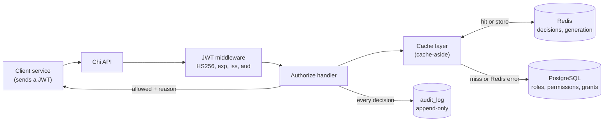
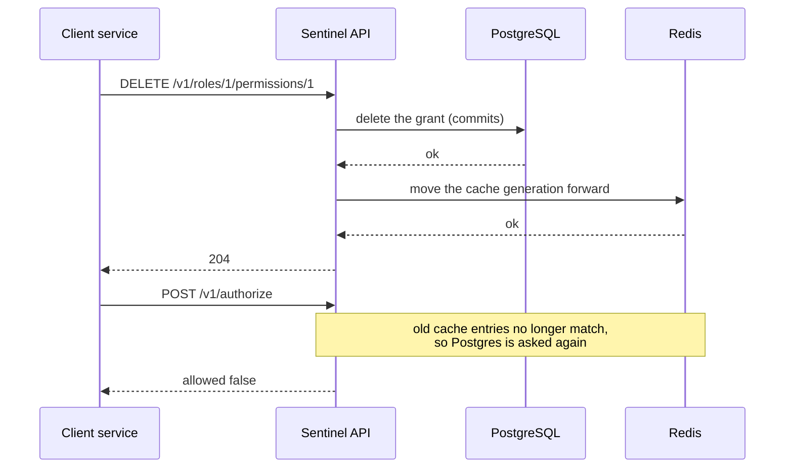

# Sentinel

[](https://github.com/ByteSizedMe/sentinel/actions/workflows/ci.yml)

Sentinel is an application-level RBAC authorization microservice written in Go.
Other services call it to ask one question: **can user X perform action Y on
resource Z?** It answers with an allow/deny decision and a reason. Anything not
explicitly allowed is denied.

- Manage roles, resources and permissions over a JSON HTTP API.
- Grant permissions to roles and assign roles to users.
- `POST /v1/authorize` returns the decision (deny by default) and records it.
- Every decision is written to an append-only audit log.
- Every `/v1` route requires a signed JWT.
- Decisions are cached in Redis and the cache is invalidated on every policy
  change. If Redis is down, Sentinel keeps working from Postgres.

**Stack:** Go, Chi, PostgreSQL (pgx, raw SQL), Redis (go-redis), golang-migrate,
Docker Compose. Design decisions are summarised in [docs/DECISIONS.md](docs/DECISIONS.md).

## Architecture



The same cache layer also wraps every policy change (grant, revoke, delete,
assign). It runs the change in Postgres first and only then invalidates Redis:



## Running locally on Windows (PowerShell)

Requirements: Go (see `go.mod`), Docker Desktop with Compose, and `make`.
Postgres is published on host port **5433** (5432 is often taken); Redis on 6379.
Both are bound to 127.0.0.1.

1. Create your local config **only if you do not have one yet**, then edit it:

   ```powershell
   if (-not (Test-Path .env)) { Copy-Item .env.example .env }
   ```

   Set a real `POSTGRES_PASSWORD` (and the same password inside
   `MIGRATE_DATABASE_URL`), a separate `APP_DB_PASSWORD` (and the same password
   inside `DATABASE_URL`, which connects as the `sentinel_app` role), and set
   `JWT_SECRET`, `JWT_ISSUER` and `JWT_AUDIENCE`. To create a strong secret:

   ```powershell
   $b = New-Object byte[] 32; [Security.Cryptography.RandomNumberGenerator]::Create().GetBytes($b); [Convert]::ToBase64String($b)
   ```

   `.env` is git-ignored. Only `.env.example` (placeholders) is committed.

2. Start Postgres and Redis, apply the migrations, give the app role its password,
   run the server:

   ```powershell
   make up
   make migrate-up
   make db-app-role
   make run
   ```

   `make` loads `.env` by itself. Migrations are never run automatically at
   startup. `make db-app-role` is needed once after the first `make migrate-up`
   (and again after a `make migrate-down`, which drops the role); see Database roles. The server refuses to start without `JWT_SECRET` (at least 32
   characters), `JWT_ISSUER`, `JWT_AUDIENCE` and `DATABASE_URL`.

3. In a second PowerShell window, mint a dev token and call the API:

   ```powershell
   # Local testing only: this token carries all three scopes (see Scopes).
   $token = make token
   $h = @{ Authorization = "Bearer $token" }
   $j = "application/json"
   $role = Invoke-RestMethod -Method Post -Uri http://localhost:8080/v1/roles -Headers $h -ContentType $j -Body '{"name":"editor"}'
   $res  = Invoke-RestMethod -Method Post -Uri http://localhost:8080/v1/resources -Headers $h -ContentType $j -Body '{"name":"invoices"}'
   $perm = Invoke-RestMethod -Method Post -Uri http://localhost:8080/v1/permissions -Headers $h -ContentType $j -Body (@{action="read"; resource_id=$res.id} | ConvertTo-Json)
   Invoke-RestMethod -Method Post -Uri "http://localhost:8080/v1/roles/$($role.id)/permissions" -Headers $h -ContentType $j -Body (@{permission_id=$perm.id} | ConvertTo-Json)
   Invoke-RestMethod -Method Post -Uri http://localhost:8080/v1/users/u1/roles -Headers $h -ContentType $j -Body (@{role_id=$role.id} | ConvertTo-Json)
   Invoke-RestMethod -Method Post -Uri http://localhost:8080/v1/authorize -Headers $h -ContentType $j -Body '{"user_id":"u1","action":"read","resource":"invoices"}'
   ```

   The last call returns `allowed: true`. `GET /health` needs no token.

4. Look inside (optional):

   ```powershell
   docker compose exec postgres psql -U sentinel -d sentinel -c "SELECT id, user_id, action, resource, allowed, source FROM audit_log ORDER BY id DESC LIMIT 10"
   docker compose exec redis redis-cli --scan
   ```

   The `source` column says whether a decision was read from `db` or the `cache`.
   Every Redis key starts with `sentinel:v1:` and has a TTL.

Press Ctrl+C to stop the server; it shuts down gracefully.

### Make targets and PowerShell equivalents

| Target                  | Does                                         | PowerShell equivalent (after loading `.env`, see below) |
|-------------------------|----------------------------------------------|---------------------------------------------------------|
| `make up`               | start Postgres and Redis                     | `docker compose up -d`                                  |
| `make down`             | stop and remove the containers               | `docker compose down`                                   |
| `make migrate-up`       | apply migrations (as the owner)              | `go run ./cmd/migrate up`                               |
| `make migrate-down`     | revert all migrations (**deletes data**)     | `go run ./cmd/migrate down`                             |
| `make db-app-role`      | set the `sentinel_app` login password from `APP_DB_PASSWORD` | `Get-Content scripts/set_app_role_password.sql \| docker compose exec -T -e APP_DB_PASSWORD postgres psql -q -U sentinel -d sentinel` |
| `make run`              | run the server                               | `go run ./cmd/sentinel`                                 |
| `make token`            | print a dev JWT, all scopes (local testing only) | `go run ./cmd/tokengen`                                 |
| `make test`             | unit tests (plus store tests if the DB is up)| `go test ./...`                                         |
| `make test-integration` | full-stack tests against Postgres and Redis  | `go test -tags integration -count=1 -v ./internal/integration/...` |
| `make bench`            | cache vs no-cache benchmarks                 | `go test -tags integration -run NONE -bench . -benchtime 500x ./internal/integration/...` |

To load `.env` into a PowerShell session by hand (only needed for the
equivalents above; `make` does it for you):

```powershell
Get-Content .env | Where-Object { $_ -match '^\s*[^#\s][^=]*=' } | ForEach-Object {
  $name, $value = $_ -split '=', 2
  Set-Item -Path "env:$($name.Trim())" -Value $value.Trim()
}
```

Values in `.env` must be plain `KEY=VALUE` lines (make reads them); a literal `$`
in a value must be written `$$`. `docker compose down -v` also deletes the
database volume.

### Tests

- `make test` runs the unit tests. The Postgres store and audit tests run only
  when `DATABASE_URL` is set and the database is up and migrated; otherwise they skip.
  `DATABASE_URL` is the `sentinel_app` role. The audit test that proves the
  append-only triggers also needs the owner connection (`MIGRATE_DATABASE_URL`).
- `make test-integration` starts the real HTTP stack in-process against the
  docker-compose Postgres and Redis. It mints a JWT, creates a role, resource and
  permission, grants, assigns, authorizes, revokes, authorizes again and checks the
  `audit_log` rows. It also runs with the cache off and with Redis unreachable.
  It skips unless `DATABASE_URL` and `REDIS_URL` are set.
- The privilege tests (`TestAppRoleRunsTheService`, `TestAppRolePrivileges`) connect
  as `sentinel_app` and check that the service works while `UPDATE`, `DELETE`,
  `TRUNCATE`, `DROP TRIGGER`, `CREATE TABLE` and reading `schema_migrations` are
  all refused. They read `APP_DATABASE_URL` and skip when it is unset;
  `make test-integration` sets it to `DATABASE_URL` by default. They fail if
  `APP_DATABASE_URL` does not connect as the non-superuser `sentinel_app`.
- The audit log is append-only, so test and benchmark runs leave rows in it.
  `make migrate-down` then `make migrate-up` clears them (and all other data).

## Configuration

All settings come from environment variables (see `.env.example`).

| Variable             | Default                    | Notes                                              |
|----------------------|----------------------------|----------------------------------------------------|
| `SENTINEL_ADDR`      | `:8080`                    | HTTP listen address                                |
| `DATABASE_URL`       | none (required)            | PostgreSQL connection string for the **server**: the `sentinel_app` role (see Database roles) |
| `MIGRATE_DATABASE_URL` | falls back to `DATABASE_URL` | database **owner** connection, used only by `cmd/migrate` (`make migrate-up` / `migrate-down`) |
| `APP_DB_PASSWORD`    | none                       | login password for `sentinel_app`, read only by `make db-app-role` (at least 16 characters) |
| `APP_DATABASE_URL`   | none                       | `sentinel_app` connection for the privilege tests; `make test-integration` defaults it to `DATABASE_URL` |
| `TRUSTED_PROXIES`    | empty                      | comma-separated IPs and CIDRs whose `X-Forwarded-For` the IP limiter believes (see Rate limiting) |
| `REDIS_URL`          | `redis://localhost:6379/0` | Redis connection URL                               |
| `CACHE_TTL_SECONDS`  | `60`                       | whole seconds, 0 to 3600; `0` turns the cache off  |
| `JWT_SECRET`         | none (required)            | HS256 signing key, at least 32 characters          |
| `JWT_ISSUER`         | none (required)            | expected `iss` claim                               |
| `JWT_AUDIENCE`       | none (required)            | expected `aud` claim                               |
| `RATE_LIMIT_IP_RPS`  | `20`                       | requests per second per client IP; `0` turns the IP limiter off |
| `RATE_LIMIT_IP_BURST` | `40`                      | requests one IP may send at once (at least 1 while the limiter is on) |
| `RATE_LIMIT_CALLER_RPS` | `50`                    | requests per second per caller (token `sub`); `0` turns it off |
| `RATE_LIMIT_CALLER_BURST` | `100`                 | requests one caller may send at once (at least 1 while the limiter is on) |
| `RATE_LIMIT_MAX_KEYS` | `10000`                   | most IPs (and, separately, callers) tracked at once; at least 100 |

The rate-limit values are whole numbers. A value that is negative, not a number
or out of range makes the server refuse to start, with a message that names the
variable (never its value).

## Rate limiting

Two token-bucket limiters protect `/v1`. `/health` is never limited.

1. **Per client IP, before authentication.** It slows down token guessing and
   floods of requests with invalid tokens, because those are refused before any
   token is checked.
2. **Per caller, after authentication.** The key is the token's `sub`, so one
   valid caller cannot hammer the service. It runs before the scope check, so a
   caller that keeps getting `403` spends its own budget too, and a request with
   an invalid token never spends anyone's.

The order on every `/v1` route is: per-IP limit, JWT check, per-caller limit,
scope check, handler. A refused request gets `429 {"error":"too many requests"}`
and a `Retry-After` header in whole seconds (at least 1). The response is the same
for both limiters, so it does not say which one fired or what the limits are. Each
bucket holds `BURST` requests and refills at `RPS` per second.

Things to know:

- **Per process, in memory.** Nothing is shared. With several instances each one
  counts on its own, so the effective limit is multiplied by the number of
  instances, and a restart resets every counter.
- **Bounded memory.** At most `RATE_LIMIT_MAX_KEYS` keys are tracked per limiter.
  When the cap is reached the least recently seen key is dropped, and idle keys
  are swept during normal calls (no background goroutine). A client that fills
  the table with many addresses can therefore push out other keys, which then
  start again with a full bucket.
- **The client IP is the TCP peer address (`r.RemoteAddr`) unless the peer is a
  trusted proxy.** With `TRUSTED_PROXIES` empty (the default) `X-Forwarded-For`,
  `X-Real-IP` and `Forwarded` are ignored: the client controls them, so honoring
  them would let anyone dodge the limit by changing a header. Behind a load
  balancer that means every client shares the balancer's address and one IP
  budget, so set `TRUSTED_PROXIES` to the balancer's addresses (see below).
  IPv6 clients are limited per full address, not per network prefix.
- **Logging.** Rejections are not logged one by one: at most one generic line per
  key per minute, with the route pattern and the IP or subject quoted. Tokens are
  never logged.

### Behind a load balancer (`TRUSTED_PROXIES`)

Set `TRUSTED_PROXIES` to the addresses of the proxies that sit directly in front
of Sentinel, for example `10.0.0.0/16` for a load balancer's subnet. It takes a
comma-separated list of IPs and CIDR ranges, IPv4 and IPv6, at most 64 entries.

- If the TCP peer is **not** in the list, headers are ignored exactly as before,
  so a client cannot invent a fresh bucket by sending `X-Forwarded-For`.
- If the peer **is** in the list, only `X-Forwarded-For` is read (never
  `X-Real-IP` or `Forwarded`). Several header lines are joined, the list is
  walked from the **right**, trusted proxies are skipped, and the first
  untrusted address is the client. Anything written further left is ignored,
  because the client can put anything there.
- A header that is missing, empty, has an unparseable entry (including entries
  with a port), has more than 20 entries, or lists only trusted proxies makes
  the limiter fall back to the peer address. The result is normalized (IPv6 zone
  removed, IPv4-mapped IPv6 written as IPv4) before it becomes the key.
- The server refuses to start on an entry it cannot parse, an empty entry, a range
  that covers everything (`0.0.0.0/0`, `::/0`: it would trust every client and make
  the header fully spoofable) or more than 64 entries. The message names the
  position, not the value.

Only the per-IP limiter uses this. The per-caller limiter still keys on the token
subject. The rules above only help if the proxy really overwrites or appends to
`X-Forwarded-For` (an AWS Application Load Balancer appends the address it saw) and
if the container is not reachable except through it.

## Database roles

Sentinel uses two database roles:

| Role | Used by | Can do |
|------|---------|--------|
| the **owner** (`MIGRATE_DATABASE_URL`) | `cmd/migrate` only | everything, including creating tables and triggers |
| `sentinel_app` (`DATABASE_URL`) | the server and the tests | `SELECT`/`INSERT`/`UPDATE`/`DELETE` on the five policy tables; `SELECT` and `INSERT` only on `audit_log`; use their sequences |

The `sentinel_app` role is created by migration `000004` as `NOLOGIN`, with no
password in any file. It has no `UPDATE`, `DELETE`, `TRUNCATE`, `REFERENCES` or
`TRIGGER` on `audit_log`, no access to `schema_migrations`, and cannot create
anything in the schema. `make db-app-role` gives it a login password from
`APP_DB_PASSWORD` in `.env`: the password is passed to `psql` through the
environment (docker is given only the variable's name, not its value) and the SQL
comes from standard input, so the password never appears in a command line or in
`make` output. The password must be at least 16 characters.

**Why two roles.** The append-only triggers stop `UPDATE`, `DELETE` and `TRUNCATE`,
but whoever owns the table can simply `DROP TRIGGER` first. If the service runs as
the owner, a bug or a stolen service credential can erase its own audit trail. With
a separate role, the database itself refuses: the app role does not own the table,
so it cannot drop or disable the triggers, and it was never given the privileges the
triggers guard. The triggers still matter, because they also stop the owner's
accidental changes.

**What this does not cover.** A superuser or the table owner is outside the app's
control and can still rewrite the log. (The docker-compose `POSTGRES_USER` is a
superuser, which is fine on a laptop; in a real deployment the owner should be a
dedicated non-superuser and its credential kept away from the service.) Sentinel
does not check at startup that it is *not* connected as a superuser or the owner;
that check is future work. Tables added by later migrations need their own `GRANT`
for `sentinel_app`; nothing is granted by default.

## Container

The `Dockerfile` builds `cmd/sentinel` and `cmd/migrate` (not `cmd/tokengen`) into a
static binary pair on a pinned `distroless/static` image that runs as the numeric
non-root user `65532` and has no shell. It contains no secrets: pass settings when
you run it.

```powershell
docker build -t sentinel .
```

Run the server. The container must be started with the **app-role** `DATABASE_URL`
(`sentinel_app`), never the owner's. Inside Docker Desktop, reach services on the
host as `host.docker.internal`:

```powershell
docker run --rm -p 8080:8080 `
  -e DATABASE_URL="postgres://sentinel_app:<APP_DB_PASSWORD>@host.docker.internal:5433/sentinel?sslmode=disable" `
  -e REDIS_URL="redis://host.docker.internal:6379/0" `
  -e JWT_SECRET="<at least 32 characters>" -e JWT_ISSUER=sentinel-dev -e JWT_AUDIENCE=sentinel-api `
  sentinel
```

Run migrations from the same image by overriding the entrypoint, with the **owner**
URL:

```powershell
docker run --rm --entrypoint /app/migrate `
  -e MIGRATE_DATABASE_URL="postgres://sentinel:<POSTGRES_PASSWORD>@host.docker.internal:5433/sentinel?sslmode=disable" `
  sentinel up
```

The SQL files are in `/app/migrations` (`MIGRATIONS_DIR` is already set). The image
has no `HEALTHCHECK` because it has no shell or `curl`; point the load balancer's
health check at `GET /health` (port 8080).

## Authentication

Every `/v1` route needs `Authorization: Bearer <jwt>`. Tokens are HS256, signed
with `JWT_SECRET`, and must carry `exp`, `iss` (= `JWT_ISSUER`), `aud`
(= `JWT_AUDIENCE`) and `sub`. A 30 second clock-skew allowance applies. Anything
else gets the same generic `401`. Other algorithms (including `none`) are
rejected. The token identifies the **calling service** (the `sub` claim, stored
in the audit log); it never decides which user an authorization check is about.

### Scopes

Having a valid token is not enough: each `/v1` route also needs a **scope** in
the token's `scope` claim. That claim is one space-separated string, such as
`"sentinel:authorize sentinel:read"`. A valid token that lacks the scope a route
needs gets `403 {"error":"forbidden"}`. The body is the same in every case and
never says which scope was needed or which the token has.

| Scope | Allows |
|-------|--------|
| `sentinel:authorize` | `POST /v1/authorize` only |
| `sentinel:read` | every `GET` under `/v1` (list and get for roles, resources, permissions, role grants and user roles) |
| `sentinel:admin` | every `POST` and `DELETE` under `/v1` except authorize (create, delete, grant, revoke, assign, remove) |

The scopes are independent: `sentinel:admin` does **not** include read or
authorize, so a token that creates roles and also needs to list them must carry
both scopes. The claim is parsed strictly: entries are split on single spaces,
matching is exact and case-sensitive, and unknown or empty entries are ignored.
A missing, empty or non-string `scope` claim (a number or an array, say) means no
scopes. Other spellings such as `scp` are not read. A route declared without a
scope in the code answers `403` to everyone, so a forgotten scope fails closed.
`/health` stays public.

A `403` is logged as one line with the route pattern and the token's `sub`
(never the token or its scopes). It is not written to the audit log, which only
records authorization decisions.

### Dev tokens

`make token` mints a short-lived dev token from your `.env`. Options:
`go run ./cmd/tokengen -sub my-service -ttl 30m -scopes "sentinel:authorize"`.
**By default the token carries all three scopes. That default is for local
testing only**: a real caller should get only the scopes it needs, for example
`sentinel:authorize` for a service that only asks questions. Never log or commit
tokens.

## API reference

All request and response bodies are JSON. Send `Authorization: Bearer <jwt>` on
every `/v1` request. **Each route also needs a scope in the token** (see
[Scopes](#scopes)): `POST /v1/authorize` needs `sentinel:authorize`, every `GET`
needs `sentinel:read`, and every other `POST` and `DELETE` needs `sentinel:admin`.
A missing scope is a `403` on any route, so it is not repeated in the tables
below. IDs are numbers returned by the create calls. Names,
resource names and actions: 1 to 64 characters from letters, digits and `_ . : -`.
User IDs: 1 to 128 characters, the same set plus `@`. Descriptions: up to 256
characters, no control characters. Request bodies are limited to 64 KB (4 KB for
`/v1/authorize`) and unknown JSON fields are rejected.

Errors look like `{"error":"not found"}`. Messages are fixed or describe the input;
they never include database details.

| Status | Meaning |
|--------|---------|
| 400 | invalid input (bad JSON, missing or malformed field, bad ID in the URL) |
| 401 | missing, invalid or expired token |
| 403 | valid token without the scope the route needs |
| 404 | not found, including a referenced role, resource or permission that does not exist |
| 409 | already exists (duplicate name, grant or assignment) |
| 413 | request body too large |
| 429 | too many requests; see `Retry-After` (and [Rate limiting](#rate-limiting)) |
| 500 | internal error (details are logged, never returned) |

Objects:

```json
Role / Resource: {"id": 1, "name": "editor", "description": "", "created_at": "2026-10-30T12:00:00Z"}
Permission:      {"id": 1, "action": "read", "resource_id": 1, "created_at": "2026-10-30T12:00:00Z"}
```

### Health

| Method and path | Auth | Responses |
|-----------------|------|-----------|
| `GET /health` | none | `200 {"status":"ok"}` |

### Authorize

`POST /v1/authorize`

Body: `{"user_id": "u1", "action": "read", "resource": "invoices"}` (all required).
`user_id` is the user being checked, not the caller.

| Status | Body |
|--------|------|
| 200 allowed | `{"allowed": true, "reason": "permission granted", "matched_role": "editor"}` |
| 200 denied | `{"allowed": false, "reason": "no matching grant"}` |
| 400, 401, 413 | see the status table |
| 500 | `{"error":"internal server error"}`: the database or the audit log failed; **no decision is returned** |

Access is allowed only if one of the user's roles grants that action on that
resource. Unknown users, resources and actions are denied with the same reason,
so a caller cannot probe what exists, and the reason never lists the user's roles.

### Roles

| Method and path | Body | Success | Other statuses |
|-----------------|------|---------|----------------|
| `POST /v1/roles` | `{"name": "editor", "description": ""}` (`name` required) | `201` Role | 400, 401, 409 duplicate name, 413 |
| `GET /v1/roles` | | `200` array of Role | 401 |
| `GET /v1/roles/{id}` | | `200` Role | 400, 401, 404 |
| `DELETE /v1/roles/{id}` | | `204` (also removes its grants and assignments) | 400, 401, 404 |

### Resources

| Method and path | Body | Success | Other statuses |
|-----------------|------|---------|----------------|
| `POST /v1/resources` | `{"name": "invoices", "description": ""}` (`name` required) | `201` Resource | 400, 401, 409 duplicate name, 413 |
| `GET /v1/resources` | | `200` array of Resource | 401 |
| `GET /v1/resources/{id}` | | `200` Resource | 400, 401, 404 |
| `DELETE /v1/resources/{id}` | | `204` (also removes its permissions) | 400, 401, 404 |

### Permissions

A permission is one action on one resource.

| Method and path | Body | Success | Other statuses |
|-----------------|------|---------|----------------|
| `POST /v1/permissions` | `{"action": "read", "resource_id": 1}` (both required) | `201` Permission | 400, 401, 404 resource does not exist, 409 duplicate, 413 |
| `GET /v1/permissions` | | `200` array of Permission | 401 |
| `GET /v1/permissions/{id}` | | `200` Permission | 400, 401, 404 |
| `DELETE /v1/permissions/{id}` | | `204` (also removes its grants) | 400, 401, 404 |

### Granting permissions to roles

| Method and path | Body | Success | Other statuses |
|-----------------|------|---------|----------------|
| `POST /v1/roles/{id}/permissions` | `{"permission_id": 1}` | `201` `{"role_id": 1, "permission_id": 1}` | 400, 401, 404 role or permission missing, 409 already granted, 413 |
| `GET /v1/roles/{id}/permissions` | | `200` array of Permission | 400, 401, 404 role missing |
| `DELETE /v1/roles/{id}/permissions/{permissionID}` | | `204` | 400, 401, 404 grant not found |

### Assigning roles to users

| Method and path | Body | Success | Other statuses |
|-----------------|------|---------|----------------|
| `POST /v1/users/{userID}/roles` | `{"role_id": 1}` | `201` `{"user_id": "u1", "role_id": 1}` | 400, 401, 404 role missing, 409 already assigned, 413 |
| `GET /v1/users/{userID}/roles` | | `200` array of Role (empty if none) | 400, 401 |
| `DELETE /v1/users/{userID}/roles/{roleID}` | | `204` | 400, 401, 404 assignment not found |

Scopes by route: `GET` routes need `sentinel:read`; `POST` and `DELETE` routes
above need `sentinel:admin`; `POST /v1/authorize` needs `sentinel:authorize`.
Scopes live in the token, which is signed with the shared HS256 secret, so
anyone who holds `JWT_SECRET` can mint a token with any scope (see Limitations).

## Caching

`/v1/authorize` is cache-aside: look in Redis, on a miss ask Postgres, store the answer.

- **Keys.** `sentinel:v1:dec:<sha256>` holds one decision for one (user, action,
  resource); `sentinel:v1:gen` holds the current "generation". Every key has a
  TTL (`CACHE_TTL_SECONDS` for decisions, 24 hours for the generation). The
  decision key is a hash of the three length-prefixed fields, so one user's entry
  can never be served for another, and user IDs do not appear in Redis keys.
- **Values.** Only what Postgres answered (allowed, matched role). Nothing from
  the request or the JWT is stored as data. Denials are cached too.
- **Invalidation.** Each entry is stamped with the generation that was current
  when its lookup started. Any change that can alter a decision (grant, revoke,
  delete role/permission/resource, assign or remove a role) moves the generation
  forward *after* the database change has committed, so all older entries stop
  matching at once. All of this lives in one type, `cache.CachedStore`, which
  implements every store method explicitly, so a write path cannot skip it.
- **Fail safe.** A Redis error is never fatal and never produces an allow: the
  request falls through to Postgres, one generic warning is logged (no keys, users
  or tokens) and the cache is skipped for 5 seconds. If invalidation itself fails,
  the cache is skipped for one full TTL so no stale entry can be served.
- **Audit.** Cache hits are audited like any other decision, with `source = cache`.

## Security design

- **Deny by default.** The only way to get `allowed: true` is for the decision
  query to find a grant. Unknown users, resources, actions and every error path end
  in a denial or a `500`, never an allow.
- **Parameterized SQL only.** Every query uses `$1, $2, ...` placeholders. There is no ORM
  and no string-built SQL.
- **Strict input validation.** Allow-listed characters, length limits, a body size
  limit and rejection of unknown JSON fields, before anything reaches the database.
- **Rate limiting.** A per-IP limit before authentication and a per-caller limit
  after it, with bounded memory and a fixed `429` response (see Rate limiting).
- **Scopes on every route.** A token must carry the scope its route needs
  (`sentinel:authorize`, `sentinel:read` or `sentinel:admin`), so a caller that
  may only ask questions cannot change policy. A route with no scope declared
  answers `403`, and a test fails if a `/v1` route is added without one.
- **JWT checks.** HS256 only (so `none` and algorithm-confusion tokens fail); `exp`,
  `iss`, `aud` and `sub` are required; a short clock-skew allowance; one generic
  `401` for every failure; tokens are never logged. The secret must be 32+ characters
  and the server will not start without it.
- **Append-only audit log.** One row per decision, allow or deny, including cache
  hits. Database triggers reject `UPDATE`, `DELETE` and `TRUNCATE`. If the audit
  write fails the response is a `500` and the decision is withheld (fail closed).
- **Least-privilege database role.** The server connects as `sentinel_app`, which can
  only `SELECT` and `INSERT` on `audit_log` and cannot drop its triggers (see Database
  roles).
- **No leaks.** Internal errors are logged server-side and replaced by a fixed
  message. Denial reasons never reveal a user's roles.
- **Secrets.** Configuration comes from environment variables. Only
  `.env.example` with placeholders is committed. Redis and Postgres are bound to
  127.0.0.1 in `docker-compose.yml`.

## Performance

Numbers from `make bench` on one local machine (Windows 11, Intel i7-10750H, Go 1.27,
Postgres 16 and Redis 7 in Docker Desktop containers). They vary from run to run and
are **not** a production claim.

| Benchmark (average per operation)               | Postgres only / cache off | Cache warm |
|-------------------------------------------------|---------------------------|------------|
| Decision lookup                                 | 3.9 to 4.0 ms             | 3.6 to 3.8 ms |
| `/v1/authorize`, audit log kept in memory       | 4.2 ms                    | 3.8 ms     |
| `/v1/authorize`, audit log in Postgres (real)   | 38 to 43 ms               | 25 to 44 ms |
| Baseline: `SELECT 1` / Redis `PING`             | 3.5 to 3.6 ms / 3.5 to 3.6 ms | |

What this shows: on this machine every round trip to a container costs about
3.5 ms (Docker Desktop's port forwarding on Windows), so a Redis hit and a
Postgres lookup cost almost the same, and the cache saves only about 0.3 ms
(under 10%) per decision. The real `/v1/authorize` is dominated by the
audit-log insert (roughly 35 ms here), which is never cached, so the warm and
cold results overlap. The cache is expected to help more when Postgres is remote,
loaded or slower than this local setup; it was not measured here.

## Limitations and future work

- No role hierarchies, deny rules or wildcard permissions: access is an exact
  (user's role, action, resource) match.
- HS256 with a shared secret only. RS256 and JWKS key rotation are not supported.
- Scopes are coarse: three independent scopes for the whole API, not per resource
  or per role, and there is no callers table or token revocation. The scopes are
  inside a token signed with the shared HS256 secret, so anyone who holds
  `JWT_SECRET` can mint a token with any scope (including `sentinel:admin`). Treat
  the secret like an admin credential, and issue tokens with the fewest scopes each
  caller needs. A token's lifetime is not capped by the server.
- Single instance. The cache's failure handling (the 5 second skip and the
  skip-for-one-TTL after a failed invalidation) is kept in memory per process; with
  several instances it would need to be shared.
- Rate limits are per process and in memory, so they do not add up across
  instances. Behind a proxy the client IP comes from `X-Forwarded-For` only for
  peers listed in `TRUSTED_PROXIES`, and IPv6 clients are limited per full address,
  not per /64 (see Rate limiting). Redis memory is still not capped: a caller
  can create many cache entries within its rate limit, and they expire after the TTL.
- The service runs as the low-privilege `sentinel_app` role, which cannot touch
  the audit triggers, but a superuser or the table owner still can (see Database
  roles). Sentinel does not yet check at startup that it is not connected as one.
- List endpoints have no pagination.
- Redis is trusted: cache entries are not signed, so Redis must stay on a private network.

## Project layout

```
cmd/sentinel      server entry point
cmd/migrate       runs the SQL migrations
cmd/tokengen      mints a dev JWT for local testing (not in the container image)
Dockerfile        multi-stage build of sentinel and migrate on distroless
scripts/          SQL run by make db-app-role and by CI
migrations/       plain SQL up/down files (golang-migrate)
docs/DECISIONS.md short design-decision records
internal/config   environment-based config
internal/httpapi  Chi router and handlers (including /v1/authorize)
internal/rbac     domain types, validation, PolicyStore interface
internal/store    PostgreSQL implementation of PolicyStore (pgx)
internal/auth     JWT validation and middleware
internal/audit    append-only audit log
internal/cache    Redis decision cache and invalidating store wrapper
internal/ratelimit  in-memory token-bucket rate limiter
internal/clientip trusted-proxy handling for the per-IP limiter
internal/integration  full-stack tests and benchmarks (build tag: integration)
```
