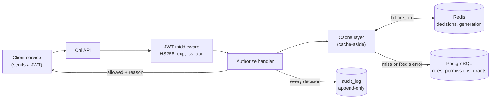
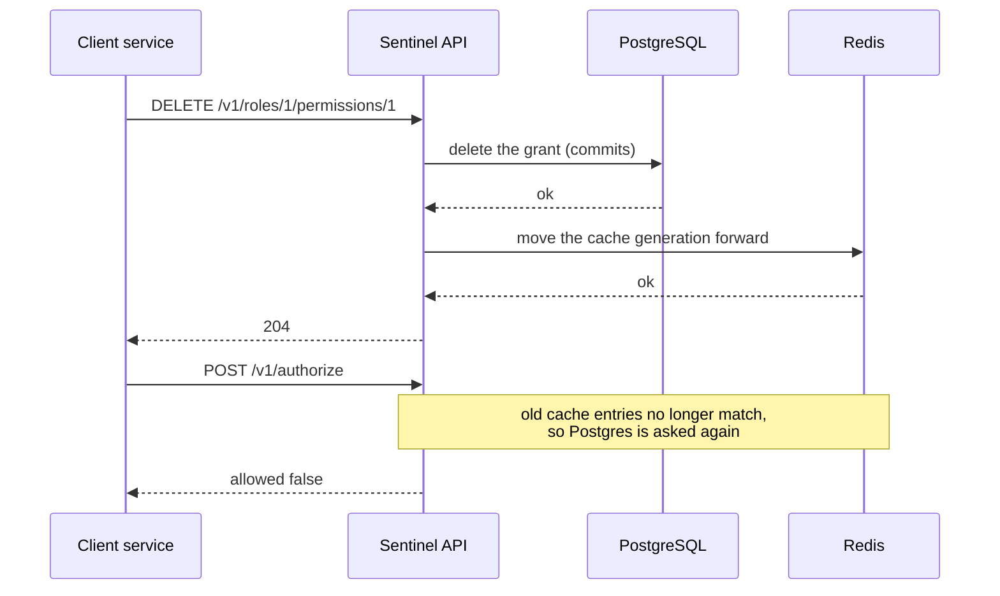

# Sentinel

Sentinel is an application-level RBAC authorization microservice written in Go.
Other services call it to ask one question: **can user X perform action Y on
resource Z?** It answers with an allow/deny decision and a reason. Anything not
explicitly allowed is denied.

- Manage roles, resources and permissions over a JSON HTTP API.
- Grant permissions to roles and assign roles to users.
- `POST /v1/authorize` returns the decision (deny by default) and records it.
- Every decision is written to an append-only audit log.
- Every `/v1` route requires a signed JWT.
- Decisions are cached in Redis and the cache is invalidated on every policy
  change. If Redis is down, Sentinel keeps working from Postgres.

**Stack:** Go, Chi, PostgreSQL (pgx, raw SQL), Redis (go-redis), golang-migrate,
Docker Compose. Design decisions are summarised in [docs/DECISIONS.md](docs/DECISIONS.md).

## Architecture



The same cache layer also wraps every policy change (grant, revoke, delete,
assign). It runs the change in Postgres first and only then invalidates Redis:



## Running locally on Windows (PowerShell)

Requirements: Go (see `go.mod`), Docker Desktop with Compose, and `make`.
Postgres is published on host port **5433** (5432 is often taken); Redis on 6379.
Both are bound to 127.0.0.1.

1. Create your local config **only if you do not have one yet**, then edit it:

   ```powershell
   if (-not (Test-Path .env)) { Copy-Item .env.example .env }
   ```

   Set a real `POSTGRES_PASSWORD` (and the same password inside `DATABASE_URL`),
   and set `JWT_SECRET`, `JWT_ISSUER` and `JWT_AUDIENCE`. To create a strong secret:

   ```powershell
   $b = New-Object byte[] 32; [Security.Cryptography.RandomNumberGenerator]::Create().GetBytes($b); [Convert]::ToBase64String($b)
   ```

   `.env` is git-ignored. Only `.env.example` (placeholders) is committed.

2. Start Postgres and Redis, apply the migrations, run the server:

   ```powershell
   make up
   make migrate-up
   make run
   ```

   `make` loads `.env` by itself. Migrations are never run automatically at
   startup. The server refuses to start without `JWT_SECRET` (at least 32
   characters), `JWT_ISSUER`, `JWT_AUDIENCE` and `DATABASE_URL`.

3. In a second PowerShell window, mint a dev token and call the API:

   ```powershell
   $token = make token
   $h = @{ Authorization = "Bearer $token" }
   $j = "application/json"
   $role = Invoke-RestMethod -Method Post -Uri http://localhost:8080/v1/roles -Headers $h -ContentType $j -Body '{"name":"editor"}'
   $res  = Invoke-RestMethod -Method Post -Uri http://localhost:8080/v1/resources -Headers $h -ContentType $j -Body '{"name":"invoices"}'
   $perm = Invoke-RestMethod -Method Post -Uri http://localhost:8080/v1/permissions -Headers $h -ContentType $j -Body (@{action="read"; resource_id=$res.id} | ConvertTo-Json)
   Invoke-RestMethod -Method Post -Uri "http://localhost:8080/v1/roles/$($role.id)/permissions" -Headers $h -ContentType $j -Body (@{permission_id=$perm.id} | ConvertTo-Json)
   Invoke-RestMethod -Method Post -Uri http://localhost:8080/v1/users/u1/roles -Headers $h -ContentType $j -Body (@{role_id=$role.id} | ConvertTo-Json)
   Invoke-RestMethod -Method Post -Uri http://localhost:8080/v1/authorize -Headers $h -ContentType $j -Body '{"user_id":"u1","action":"read","resource":"invoices"}'
   ```

   The last call returns `allowed: true`. `GET /health` needs no token.

4. Look inside (optional):

   ```powershell
   docker compose exec postgres psql -U sentinel -d sentinel -c "SELECT id, user_id, action, resource, allowed, source FROM audit_log ORDER BY id DESC LIMIT 10"
   docker compose exec redis redis-cli --scan
   ```

   The `source` column says whether a decision was read from `db` or the `cache`.
   Every Redis key starts with `sentinel:v1:` and has a TTL.

Press Ctrl+C to stop the server; it shuts down gracefully.

### Make targets and PowerShell equivalents

| Target                  | Does                                         | PowerShell equivalent (after loading `.env`, see below) |
|-------------------------|----------------------------------------------|---------------------------------------------------------|
| `make up`               | start Postgres and Redis                     | `docker compose up -d`                                  |
| `make down`             | stop and remove the containers               | `docker compose down`                                   |
| `make migrate-up`       | apply migrations                             | `go run ./cmd/migrate up`                               |
| `make migrate-down`     | revert all migrations (**deletes data**)     | `go run ./cmd/migrate down`                             |
| `make run`              | run the server                               | `go run ./cmd/sentinel`                                 |
| `make token`            | print a dev JWT (local testing only)         | `go run ./cmd/tokengen`                                 |
| `make test`             | unit tests (plus store tests if the DB is up)| `go test ./...`                                         |
| `make test-integration` | full-stack tests against Postgres and Redis  | `go test -tags integration -count=1 -v ./internal/integration/...` |
| `make bench`            | cache vs no-cache benchmarks                 | `go test -tags integration -run NONE -bench . -benchtime 500x ./internal/integration/...` |

To load `.env` into a PowerShell session by hand (only needed for the
equivalents above; `make` does it for you):

```powershell
Get-Content .env | Where-Object { $_ -match '^\s*[^#\s][^=]*=' } | ForEach-Object {
  $name, $value = $_ -split '=', 2
  Set-Item -Path "env:$($name.Trim())" -Value $value.Trim()
}
```

Values in `.env` must be plain `KEY=VALUE` lines (make reads them); a literal `$`
in a value must be written `$$`. `docker compose down -v` also deletes the
database volume.

### Tests

- `make test` runs the unit tests. The Postgres store and audit tests run only
  when `DATABASE_URL` is set and the database is up and migrated; otherwise they skip.
- `make test-integration` starts the real HTTP stack in-process against the
  docker-compose Postgres and Redis. It mints a JWT, creates a role, resource and
  permission, grants, assigns, authorizes, revokes, authorizes again and checks the
  `audit_log` rows. It also runs with the cache off and with Redis unreachable.
  It skips unless `DATABASE_URL` and `REDIS_URL` are set.
- The audit log is append-only, so test and benchmark runs leave rows in it.
  `make migrate-down` then `make migrate-up` clears them (and all other data).

## Configuration

All settings come from environment variables (see `.env.example`).

| Variable             | Default                    | Notes                                              |
|----------------------|----------------------------|----------------------------------------------------|
| `SENTINEL_ADDR`      | `:8080`                    | HTTP listen address                                |
| `DATABASE_URL`       | none (required)            | PostgreSQL connection string                       |
| `REDIS_URL`          | `redis://localhost:6379/0` | Redis connection URL                               |
| `CACHE_TTL_SECONDS`  | `60`                       | whole seconds, 0 to 3600; `0` turns the cache off  |
| `JWT_SECRET`         | none (required)            | HS256 signing key, at least 32 characters          |
| `JWT_ISSUER`         | none (required)            | expected `iss` claim                               |
| `JWT_AUDIENCE`       | none (required)            | expected `aud` claim                               |

## Authentication

Every `/v1` route needs `Authorization: Bearer <jwt>`. Tokens are HS256, signed
with `JWT_SECRET`, and must carry `exp`, `iss` (= `JWT_ISSUER`), `aud`
(= `JWT_AUDIENCE`) and `sub`. A 30 second clock-skew allowance applies. Anything
else gets the same generic `401`. Other algorithms (including `none`) are
rejected. The token identifies the **calling service** (the `sub` claim, stored
in the audit log); it never decides which user an authorization check is about.

`make token` mints a short-lived dev token from your `.env`. Options:
`go run ./cmd/tokengen -sub my-service -ttl 30m`. Never log or commit tokens.

## API reference

All request and response bodies are JSON. Send `Authorization: Bearer <jwt>` on
every `/v1` request. IDs are numbers returned by the create calls. Names,
resource names and actions: 1 to 64 characters from letters, digits and `_ . : -`.
User IDs: 1 to 128 characters, the same set plus `@`. Descriptions: up to 256
characters, no control characters. Request bodies are limited to 64 KB (4 KB for
`/v1/authorize`) and unknown JSON fields are rejected.

Errors look like `{"error":"not found"}`. Messages are fixed or describe the input;
they never include database details.

| Status | Meaning |
|--------|---------|
| 400 | invalid input (bad JSON, missing or malformed field, bad ID in the URL) |
| 401 | missing, invalid or expired token |
| 404 | not found, including a referenced role, resource or permission that does not exist |
| 409 | already exists (duplicate name, grant or assignment) |
| 413 | request body too large |
| 500 | internal error (details are logged, never returned) |

Objects:

```json
Role / Resource: {"id": 1, "name": "editor", "description": "", "created_at": "2026-10-30T12:00:00Z"}
Permission:      {"id": 1, "action": "read", "resource_id": 1, "created_at": "2026-10-30T12:00:00Z"}
```

### Health

| Method and path | Auth | Responses |
|-----------------|------|-----------|
| `GET /health` | none | `200 {"status":"ok"}` |

### Authorize

`POST /v1/authorize`

Body: `{"user_id": "u1", "action": "read", "resource": "invoices"}` (all required).
`user_id` is the user being checked, not the caller.

| Status | Body |
|--------|------|
| 200 allowed | `{"allowed": true, "reason": "permission granted", "matched_role": "editor"}` |
| 200 denied | `{"allowed": false, "reason": "no matching grant"}` |
| 400, 401, 413 | see the status table |
| 500 | `{"error":"internal server error"}`: the database or the audit log failed; **no decision is returned** |

Access is allowed only if one of the user's roles grants that action on that
resource. Unknown users, resources and actions are denied with the same reason,
so a caller cannot probe what exists, and the reason never lists the user's roles.

### Roles

| Method and path | Body | Success | Other statuses |
|-----------------|------|---------|----------------|
| `POST /v1/roles` | `{"name": "editor", "description": ""}` (`name` required) | `201` Role | 400, 401, 409 duplicate name, 413 |
| `GET /v1/roles` | | `200` array of Role | 401 |
| `GET /v1/roles/{id}` | | `200` Role | 400, 401, 404 |
| `DELETE /v1/roles/{id}` | | `204` (also removes its grants and assignments) | 400, 401, 404 |

### Resources

| Method and path | Body | Success | Other statuses |
|-----------------|------|---------|----------------|
| `POST /v1/resources` | `{"name": "invoices", "description": ""}` (`name` required) | `201` Resource | 400, 401, 409 duplicate name, 413 |
| `GET /v1/resources` | | `200` array of Resource | 401 |
| `GET /v1/resources/{id}` | | `200` Resource | 400, 401, 404 |
| `DELETE /v1/resources/{id}` | | `204` (also removes its permissions) | 400, 401, 404 |

### Permissions

A permission is one action on one resource.

| Method and path | Body | Success | Other statuses |
|-----------------|------|---------|----------------|
| `POST /v1/permissions` | `{"action": "read", "resource_id": 1}` (both required) | `201` Permission | 400, 401, 404 resource does not exist, 409 duplicate, 413 |
| `GET /v1/permissions` | | `200` array of Permission | 401 |
| `GET /v1/permissions/{id}` | | `200` Permission | 400, 401, 404 |
| `DELETE /v1/permissions/{id}` | | `204` (also removes its grants) | 400, 401, 404 |

### Granting permissions to roles

| Method and path | Body | Success | Other statuses |
|-----------------|------|---------|----------------|
| `POST /v1/roles/{id}/permissions` | `{"permission_id": 1}` | `201` `{"role_id": 1, "permission_id": 1}` | 400, 401, 404 role or permission missing, 409 already granted, 413 |
| `GET /v1/roles/{id}/permissions` | | `200` array of Permission | 400, 401, 404 role missing |
| `DELETE /v1/roles/{id}/permissions/{permissionID}` | | `204` | 400, 401, 404 grant not found |

### Assigning roles to users

| Method and path | Body | Success | Other statuses |
|-----------------|------|---------|----------------|
| `POST /v1/users/{userID}/roles` | `{"role_id": 1}` | `201` `{"user_id": "u1", "role_id": 1}` | 400, 401, 404 role missing, 409 already assigned, 413 |
| `GET /v1/users/{userID}/roles` | | `200` array of Role (empty if none) | 400, 401 |
| `DELETE /v1/users/{userID}/roles/{roleID}` | | `204` | 400, 401, 404 assignment not found |

Any valid token can call every endpoint above, including the policy-changing
ones. There are no per-caller permissions yet (see Limitations).

## Caching

`/v1/authorize` is cache-aside: look in Redis, on a miss ask Postgres, store the answer.

- **Keys.** `sentinel:v1:dec:<sha256>` holds one decision for one (user, action,
  resource); `sentinel:v1:gen` holds the current "generation". Every key has a
  TTL (`CACHE_TTL_SECONDS` for decisions, 24 hours for the generation). The
  decision key is a hash of the three length-prefixed fields, so one user's entry
  can never be served for another, and user IDs do not appear in Redis keys.
- **Values.** Only what Postgres answered (allowed, matched role). Nothing from
  the request or the JWT is stored as data. Denials are cached too.
- **Invalidation.** Each entry is stamped with the generation that was current
  when its lookup started. Any change that can alter a decision (grant, revoke,
  delete role/permission/resource, assign or remove a role) moves the generation
  forward *after* the database change has committed, so all older entries stop
  matching at once. All of this lives in one type, `cache.CachedStore`, which
  implements every store method explicitly, so a write path cannot skip it.
- **Fail safe.** A Redis error is never fatal and never produces an allow: the
  request falls through to Postgres, one generic warning is logged (no keys, users
  or tokens) and the cache is skipped for 5 seconds. If invalidation itself fails,
  the cache is skipped for one full TTL so no stale entry can be served.
- **Audit.** Cache hits are audited like any other decision, with `source = cache`.

## Security design

- **Deny by default.** The only way to get `allowed: true` is for the decision
  query to find a grant. Unknown users, resources, actions and every error path end
  in a denial or a `500`, never an allow.
- **Parameterized SQL only.** Every query uses `$1, $2, ...` placeholders. There is no ORM
  and no string-built SQL.
- **Strict input validation.** Allow-listed characters, length limits, a body size
  limit and rejection of unknown JSON fields, before anything reaches the database.
- **JWT checks.** HS256 only (so `none` and algorithm-confusion tokens fail); `exp`,
  `iss`, `aud` and `sub` are required; a short clock-skew allowance; one generic
  `401` for every failure; tokens are never logged. The secret must be 32+ characters
  and the server will not start without it.
- **Append-only audit log.** One row per decision, allow or deny, including cache
  hits. Database triggers reject `UPDATE`, `DELETE` and `TRUNCATE`. If the audit
  write fails the response is a `500` and the decision is withheld (fail closed).
- **No leaks.** Internal errors are logged server-side and replaced by a fixed
  message. Denial reasons never reveal a user's roles.
- **Secrets.** Configuration comes from environment variables. Only
  `.env.example` with placeholders is committed. Redis and Postgres are bound to
  127.0.0.1 in `docker-compose.yml`.

## Performance

Numbers from `make bench` on one local machine (Windows 11, Intel i7-10750H, Go 1.27,
Postgres 16 and Redis 7 in Docker Desktop containers). They vary from run to run and
are **not** a production claim.

| Benchmark (average per operation)               | Postgres only / cache off | Cache warm |
|-------------------------------------------------|---------------------------|------------|
| Decision lookup                                 | 3.9 to 4.0 ms             | 3.6 to 3.8 ms |
| `/v1/authorize`, audit log kept in memory       | 4.2 ms                    | 3.8 ms     |
| `/v1/authorize`, audit log in Postgres (real)   | 38 to 43 ms               | 25 to 44 ms |
| Baseline: `SELECT 1` / Redis `PING`             | 3.5 to 3.6 ms / 3.5 to 3.6 ms | |

What this shows: on this machine every round trip to a container costs about
3.5 ms (Docker Desktop's port forwarding on Windows), so a Redis hit and a
Postgres lookup cost almost the same, and the cache saves only about 0.3 ms
(under 10%) per decision. The real `/v1/authorize` is dominated by the
audit-log insert (roughly 35 ms here), which is never cached, so the warm and
cold results overlap. The cache is expected to help more when Postgres is remote,
loaded or slower than this local setup; it was not measured here.

## Limitations and future work

- No role hierarchies, deny rules or wildcard permissions: access is an exact
  (user's role, action, resource) match.
- HS256 with a shared secret only. RS256 and JWKS key rotation are not supported.
- Authentication is "any valid token": every token holder can use the policy
  management endpoints. Per-caller permissions are future work.
- Single instance. The cache's failure handling (the 5 second skip and the
  skip-for-one-TTL after a failed invalidation) is kept in memory per process; with
  several instances it would need to be shared.
- No rate limiting. A caller with a token can create many cache entries; they
  expire after the TTL, but memory use in Redis is not otherwise capped.
- The audit table owner can still drop the triggers; a separate low-privilege
  database role for the app would harden this.
- List endpoints have no pagination.
- Redis is trusted: cache entries are not signed, so Redis must stay on a private network.

## Project layout

```
cmd/sentinel      server entry point
cmd/migrate       runs the SQL migrations
cmd/tokengen      mints a dev JWT for local testing
migrations/       plain SQL up/down files (golang-migrate)
docs/DECISIONS.md short design-decision records
internal/config   environment-based config
internal/httpapi  Chi router and handlers (including /v1/authorize)
internal/rbac     domain types, validation, PolicyStore interface
internal/store    PostgreSQL implementation of PolicyStore (pgx)
internal/auth     JWT validation and middleware
internal/audit    append-only audit log
internal/cache    Redis decision cache and invalidating store wrapper
internal/integration  full-stack tests and benchmarks (build tag: integration)
```
